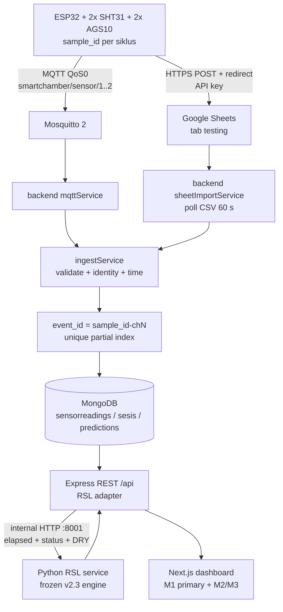

# Arsitektur

**Prinsip: dual send — single ingest — idempotent storage.**

ESP32 mengirim setiap siklus ke **dua** tujuan: MQTT (real-time) dan Google Sheets
(arsip + cadangan). Keduanya bermuara di satu jalur ingest yang sama, dan MongoDB
menyimpan **satu** dokumen per kejadian chamber.



## Firmware: ada beberapa varian

| Path | Status | Isi |
|---|---|---|
| `firmware/toscha_esp32_bench/toscha_esp32_bench.ino` | **source of truth (bench)** | 2 chamber, MQTT + Sheets, Wi-Fi persisten, NTP, `sample_id`, tanpa deep sleep |
| `firmware/toscha_esp32/toscha_esp32.ino` | legacy | percobaan integrasi lama (deep sleep, tanpa `sample_id`) |
| `firmware/src/main.cpp` + `firmware/include/config.h` | legacy | PlatformIO 1 chamber, MQTT saja |

Sketsa bench adalah turunan dari firmware bench-test V2 yang sudah terbukti
mengirim ke Sheet. Perubahan hanya menambah publish MQTT; pembacaan sensor,
pemetaan I2C, NTP, `sample_id`, dan penanganan redirect Google tidak diubah.

### Pemetaan sensor (terverifikasi lewat I2C scan)

```text
Bus A / Wire  : SDA 21, SCL 22
  SHT31 #1 0x44  -> Chamber 1 (suhu/RH)
  SHT31 #2 0x45  -> Chamber 2 (suhu/RH)
  AGS10 #1 0x1A  -> Chamber 1 (TVOC)
Bus B / Wire1 : SDA 16, SCL 17
  AGS10 #2 0x1A  -> Chamber 2 (TVOC)
```

Pemetaan bus/alamat I2C sudah terbukti. **Kepemilikan fisik sensor terhadap
chamber (label Chamber 1/2) belum diuji independen.** Lihat checklist pengujian.

## Identitas event dan deduplikasi

```text
sample_id          = <device_id>-<epoch>-<sequence>
event_id (ch n)    = <sample_id>-ch<n>
```

- Jalur MQTT memakai `event_id` dari payload (atau menurunkannya dari `sample_id`).
- Jalur Sheet menurunkan `event_id` yang sama dari kolom `sample_id` + nomor kolom.
- `sensorreadings.eventId` memiliki **unique partial index**; duplikat dari jalur
  mana pun ditolak dan hanya menambah `sources` (`["mqtt","sheet"]`).
- Efek samping (buat sesi, prediksi, `readingCount`, notifikasi) hanya terjadi
  pada insert pertama.
- Baris lama tanpa `eventId` tidak terkena index parsial dan tetap berfungsi.

## Semantik waktu

| Field | Arti |
|---|---|
| `sampled_at` | waktu alat mengukur (NTP, UTC) |
| `received_at` | waktu backend/Sheet menerima |
| `timestamp` | waktu efektif untuk pengurutan = `sampled_at` bila sah, jika tidak `received_at` |
| `timestampSource` | `sampled` / `received_at` |
| `timestampQuality` | `OK` / `MISSING` / `INVALID` |

Toleransi waktu sampel di masa depan adalah **15 menit** dari waktu terima.
Firmware memakai NTP; toleransi ini menyerap clock skew/network delay normal,
sedangkan skew lebih besar ditandai `INVALID` dan waktu terima dipakai. RSL tidak
memakai timestamp sampel sebagai acuan; ia memakai `Experiment.startedAt`.

Waktu terima tidak pernah dipalsukan sebagai waktu sampel. Event yang datang
terlambat tetap diurutkan menurut `sampled_at`, dan t0 sesi tidak bergerak mundur.

Pada skema Sheet lama, kolom `timestamp` dibuat Apps Script dengan `new Date()`
saat request diterima. Importer memperlakukannya sebagai `receivedAt`, bukan
`sampledAt`; baris lama karena itu ditandai `timestampQuality = MISSING`.

## Sumber dan fallback

| `SHEET_MODE` | Perilaku |
|---|---|
| `primary` | Semua baris baru di Sheet dicoba diimpor; duplikat MQTT ditolak oleh `eventId` |
| `fallback` | Sama, tetapi baris tanpa `sample_id` (data lama) memakai pemeriksaan kedekatan waktu |

Untuk firmware baru yang selalu mengirim `sample_id`, kedua mode menghasilkan
satu dokumen per event. `fallback` tetap disarankan agar data lama tidak dobel.
Sheet hanya diimpor jika ada eksperimen aktif dan sesi chamber yang sesuai; tanpa
itu importer tidak membuat sesi/reading dan akan mencoba lagi pada poll berikutnya.

### Importer outcomes dan quarantine

`ImportCursor` tetap menjadi high-water mark per chamber. Setiap baris juga
mencatat `ImportReceipt` durable dengan identitas `sheet:<sourceId>:<rowIndex>:ch<n>`
dan fingerprint baris. Status terminal (`IMPORTED`, `DUPLICATE`,
`QUARANTINED_INVALID`, `UNASSIGNED`, `QUARANTINED_INTEGRITY`,
`QUARANTINED_RETRY_EXHAUSTED`) memajukan cursor; `RETRYABLE_ERROR` tidak.
`UNASSIGNED` dan `QUARANTINED_INVALID` tidak pernah otomatis dimasukkan ke
eksperimen berikutnya; reproses harus dilakukan operator secara eksplisit.

Kebijakan sementara: TVOC `99999` pada baris Sheet dianggap sentinel invalid
(`INVALID_TVOC_SENTINEL`) dan di-quarantine, bukan diubah menjadi 0. Validasi
MQTT tidak diubah karena kontrak data belum menetapkan aturan yang sama untuk
semua sumber. `SHEET_MODE` default sekarang `fallback`; produksi tetap harus
menyetel nilainya secara eksplisit.

Importer memakai lock proses (`running`) dan lease 5 menit (diperbarui tiap 50 baris) pada `ImportCursor`.
Proses kedua yang mencoba chamber yang sama akan mendapat `locked` dan mencoba
lagi pada poll berikutnya; lease kedaluwarsa otomatis setelah crash.

**Recovery operator:** baris `UNASSIGNED`/`QUARANTINED_*` tidak diproses ulang
otomatis. Untuk mencoba lagi, operator harus menghapus receipt terkait (atau
mengubah statusnya menjadi `RETRYABLE_ERROR`) dan memundurkan cursor baris secara
eksplisit. Jangan menghapus receipt tanpa mencatat alasan.

## Broker dan keamanan

| Item | Dev | Prod |
|---|---|---|
| Port | 1883 | 1883 |
| Anonim | `allow_anonymous true` | `false` + `password_file` |
| TLS | tidak ada | **tidak ada listener 8883** |
| Persistence | `persistence true` | `true`, `max_queued_messages 5000`, `queue_qos0_messages true` |
| QoS | publish 0 / subscribe 1 → efektif 0 | sama |

Detail konfigurasi dan verifikasi broker: `docs/mqtt.md`.

Konsekuensi yang harus disadari:

- Kredensial MQTT prod berjalan **tanpa TLS** di port publik. Jangan menyebut ini
  produksi-aman. Untuk TLS: tambahkan listener 8883 + sertifikat, lalu set
  `MQTT_USE_TLS 1` dan `MQTT_CA_CERT` di `config_secrets.h`.
- Karena QoS 0, pesan bisa hilang saat backend mati (tergantung
  `queue_qos0_messages`). Google Sheets adalah jalur pemulihan, dan `eventId`
  mencegah data ganda saat keduanya tiba.
- Tidak ada LWT. Status "Terputus" dihitung dari `chamber.lastSeenAt` (3× interval).

## RSL / SSA (statistik)

RSL adalah jalur terpisah dari prediksi mock/ml-service. Diagram di atas
menambahkan service Python internal yang memuat snapshot runtime dari matematika
v2.3 beku.

- `rsl_engine/` — paket portabel. `src/v2_3/` adalah salinan byte-identik modul
  kanonik; `src/tofusense_rsl/` adalah facade M1/M2/M3 + reference JSON.
- `rsl_service/` — HTTP internal (`/health`, `/version`, `/estimate`), hanya
  `numpy`, tanpa fitting/training/network.
- `backend/src/services/rslService.js` — adapter Node: resolves experiment/session,
  `Experiment.startedAt` elapsed, explicit sample status, storage condition,
  timeout, response validation/normalization.
- `M1` adalah headline; `M2`/`M3` hanya di area analisis.
- TVOC/RH/suhu **tidak pernah** dikirim ke engine. Sensor tetap monitoring context.
- `UNKNOWN` sample status, `SPOILED`, `WATER`/`UNKNOWN` storage, negative elapsed,
  outside support, timeout, dan malformed response semuanya menghasilkan
  `UNAVAILABLE` dengan reason eksplisit; tidak ada angka pengganti.
- Saat stop, `experimentService` menutup eksperimen dengan `endedAt` dan
  `rslSnapshotStatus: PENDING` terlebih dahulu, menutup kedua sesi dengan timestamp
  yang sama, lalu memanggil reconciliation untuk menghitung/menyimpan snapshot.
  Snapshot pertama canonical; stop berulang tidak menimpa.
- Worker `rslSnapshotService` memindai eksperimen yang snapshot atau finalisasinya
  PENDING, memakai `endedAt` asli, menutup sesi orphan, hanya mengisi snapshot yang
  hilang, lalu memverifikasi dua sesi + dua snapshot sebelum menandai finalisasi
  COMPLETE. Lease + backoff mencegah loop rapat dan duplikasi lintas proses.
- `rslSnapshotStatus` dan `finalizationStatus` terpisah: snapshot bisa COMPLETE
  sementara satu sesi masih aktif; finalisasi tetap PENDING sampai sesi ditutup.
- `notifierService` memakai `rslService` yang sama. Ambang normal memakai M1
  `lowerHours`; event disimpan di `notificationevents` dengan unique identity.
  Tidak ada fallback ke mock countdown.
- `display.lowerHours/upperHours` dibulatkan ke bawah/atas untuk presentasi;
  nilai `lowerHours/upperHours` di API tetap presisi penuh.

## Siklus eksperimen

Satu eksperimen mengelompokkan dua sesi chamber untuk batch tahu yang sama.

```text
Experiment { startedAt, endedAt, status, chamberIds:[1,2] }
  └── Session chamber 1 { experimentId, masuk (first reading), ... }
  └── Session chamber 2 { experimentId, masuk (first reading), ... }
```

- `POST /api/experiments` membuat satu experiment dan dua sesi aktif. Tidak ada
  `tvoc_awal`/`suhu_awal`/`rh_awal` yang dibuat saat start; nilai itu diisi saat
  reading pertama diterima.
- `Experiment.startedAt` dibuat server (UTC) dan tidak pernah diubah oleh pesan
  terlambat.
- `Session.masuk` adalah waktu reading pertama per chamber, bukan acuan RSL.
- Ingestion mencari sesi dengan `{ experimentId, chamberId, status:'aktif' }`.
  Tidak ada pembuatan sesi dari pesan MQTT/HTTP/Sheet.
- Tanpa eksperimen aktif, ingestion ditolak `NO_ACTIVE_EXPERIMENT`; MQTT tetap
  hidup dan mencatat error, HTTP mengembalikan 409, Sheet tidak menulis.
- `POST /api/experiments/:id/stop` menutup kedua sesi dengan satu `endedAt` dan
  idempotent. Sesi historis tanpa `experimentId` tidak disentuh.
- Elapsed time/RSL untuk eksperimen baru memakai
  `(serverNow - Experiment.startedAt) / 3600000`; sesi historis tetap memakai
  `Session.masuk` untuk audit, bukan sebagai acuan RSL baru.
- Status sampel adalah field operator per sesi: `UNKNOWN` (awal), `NOT_SPOILED`,
  `SPOILED`, dengan `sampleStatusHistory`. Tidak pernah disimpulkan dari sensor.
- `storageCondition` per experiment/sesi: `DRY` didukung; `WATER`/`UNKNOWN`
  menghasilkan `UNSUPPORTED_STORAGE_CONDITION` tanpa meminjam referensi DRY.

Sesi lama (mis. CH-009/CH-010) tetap terpisah dan `experimentId`-nya null. Jangan
menggabungkannya tanpa bukti eksplisit.

## Alur satu pembacaan

1. ESP32 membangun `sample_id` + `sampled_at`, membaca 4 sensor.
2. Publish dua pesan MQTT (chamber 1 dan 2), lalu satu baris Sheet.
3. `mqttService` memvalidasi dan memanggil `ingestReading`.
4. `ingestService` menurunkan `eventId`, menolak duplikat, mencari sesi dari
   eksperimen aktif (`experimentId + chamberId + status:'aktif'`), menyimpan
   reading, memanggil prediksi (mock/ml-service), memperbarui sesi. Tidak ada
   pembuatan sesi dari pesan sensor.
5. `sheetImportService` (60 s) membaca baris baru; baris yang sudah masuk lewat
   MQTT ditolak oleh `eventId`.
6. REST API mengirim data; dashboard polling 10 s dan hitung mundur lokal 1 s.

## Batasan yang masih terbuka

- Kepemilikan fisik sensor → chamber belum dibuktikan.
- Prediksi masih `mlMock` atau ml-service eksternal; engine RSL statistik v2.3
  belum diintegrasikan.
- Baterai dan deep sleep di luar cakupan fase ini.
- Broker prod belum TLS.
- Sesi aktif lama tanpa `experimentId` harus ditutup manual sebelum eksperimen
  baru; start akan menolak dengan 409.
