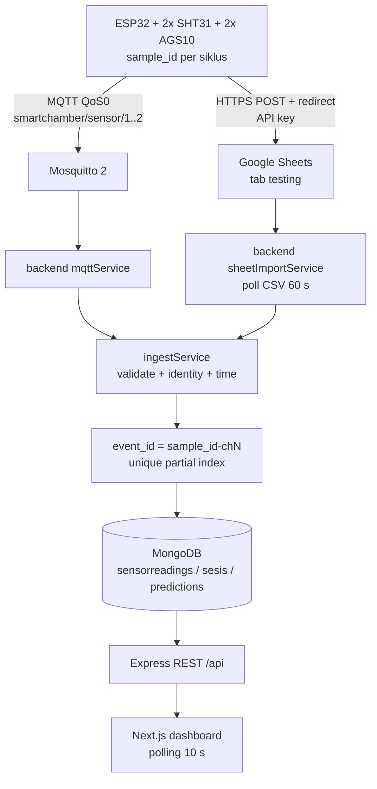

# Arsitektur

**Prinsip: dual send — single ingest — idempotent storage.**

ESP32 mengirim setiap siklus ke **dua** tujuan: MQTT (real-time) dan Google Sheets
(arsip + cadangan). Keduanya bermuara di satu jalur ingest yang sama, dan MongoDB
menyimpan **satu** dokumen per kejadian chamber.



## Firmware: ada beberapa varian

| Path | Status | Isi |
|---|---|---|
| `firmware/toscha_esp32_bench/toscha_esp32_bench.ino` | **source of truth (bench)** | 2 chamber, MQTT + Sheets, Wi-Fi persisten, NTP, `sample_id`, tanpa deep sleep |
| `firmware/toscha_esp32/toscha_esp32.ino` | legacy | percobaan integrasi lama (deep sleep, tanpa `sample_id`) |
| `firmware/src/main.cpp` + `firmware/include/config.h` | legacy | PlatformIO 1 chamber, MQTT saja |

Sketsa bench adalah turunan dari firmware bench-test V2 yang sudah terbukti
mengirim ke Sheet. Perubahan hanya menambah publish MQTT; pembacaan sensor,
pemetaan I2C, NTP, `sample_id`, dan penanganan redirect Google tidak diubah.

### Pemetaan sensor (terverifikasi lewat I2C scan)

```text
Bus A / Wire  : SDA 21, SCL 22
  SHT31 #1 0x44  -> Chamber 1 (suhu/RH)
  SHT31 #2 0x45  -> Chamber 2 (suhu/RH)
  AGS10 #1 0x1A  -> Chamber 1 (TVOC)
Bus B / Wire1 : SDA 16, SCL 17
  AGS10 #2 0x1A  -> Chamber 2 (TVOC)
```

Pemetaan bus/alamat I2C sudah terbukti. **Kepemilikan fisik sensor terhadap
chamber (label Chamber 1/2) belum diuji independen.** Lihat checklist pengujian.

## Identitas event dan deduplikasi

```text
sample_id          = <device_id>-<epoch>-<sequence>
event_id (ch n)    = <sample_id>-ch<n>
```

- Jalur MQTT memakai `event_id` dari payload (atau menurunkannya dari `sample_id`).
- Jalur Sheet menurunkan `event_id` yang sama dari kolom `sample_id` + nomor kolom.
- `sensorreadings.eventId` memiliki **unique partial index**; duplikat dari jalur
  mana pun ditolak dan hanya menambah `sources` (`["mqtt","sheet"]`).
- Efek samping (buat sesi, prediksi, `readingCount`, notifikasi) hanya terjadi
  pada insert pertama.
- Baris lama tanpa `eventId` tidak terkena index parsial dan tetap berfungsi.

## Semantik waktu

| Field | Arti |
|---|---|
| `sampled_at` | waktu alat mengukur (NTP, UTC) |
| `received_at` | waktu backend/Sheet menerima |
| `timestamp` | waktu efektif untuk pengurutan = `sampled_at` bila sah, jika tidak `received_at` |
| `timestampSource` | `sampled` / `received_at` |
| `timestampQuality` | `OK` / `MISSING` / `INVALID` |

Waktu terima tidak pernah dipalsukan sebagai waktu sampel. Event yang datang
terlambat tetap diurutkan menurut `sampled_at`, dan t0 sesi tidak bergerak mundur.

Pada skema Sheet lama, kolom `timestamp` dibuat Apps Script dengan `new Date()`
saat request diterima. Importer memperlakukannya sebagai `receivedAt`, bukan
`sampledAt`; baris lama karena itu ditandai `timestampQuality = MISSING`.

## Sumber dan fallback

| `SHEET_MODE` | Perilaku |
|---|---|
| `primary` | Semua baris baru di Sheet dicoba diimpor; duplikat MQTT ditolak oleh `eventId` |
| `fallback` | Sama, tetapi baris tanpa `sample_id` (data lama) memakai pemeriksaan kedekatan waktu |

Untuk firmware baru yang selalu mengirim `sample_id`, kedua mode menghasilkan
satu dokumen per event. `fallback` tetap disarankan agar data lama tidak dobel.

## Broker dan keamanan

| Item | Dev | Prod |
|---|---|---|
| Port | 1883 | 1883 |
| Anonim | `allow_anonymous true` | `false` + `password_file` |
| TLS | tidak ada | **tidak ada listener 8883** |
| Persistence | `persistence true` | `true`, `max_queued_messages 5000`, `queue_qos0_messages true` |
| QoS | publish 0 / subscribe 1 → efektif 0 | sama |

Detail konfigurasi dan verifikasi broker: `docs/mqtt.md`.

Konsekuensi yang harus disadari:

- Kredensial MQTT prod berjalan **tanpa TLS** di port publik. Jangan menyebut ini
  produksi-aman. Untuk TLS: tambahkan listener 8883 + sertifikat, lalu set
  `MQTT_USE_TLS 1` dan `MQTT_CA_CERT` di `config_secrets.h`.
- Karena QoS 0, pesan bisa hilang saat backend mati (tergantung
  `queue_qos0_messages`). Google Sheets adalah jalur pemulihan, dan `eventId`
  mencegah data ganda saat keduanya tiba.
- Tidak ada LWT. Status "Terputus" dihitung dari `chamber.lastSeenAt` (3× interval).

## Alur satu pembacaan

1. ESP32 membangun `sample_id` + `sampled_at`, membaca 4 sensor.
2. Publish dua pesan MQTT (chamber 1 dan 2), lalu satu baris Sheet.
3. `mqttService` memvalidasi dan memanggil `ingestReading`.
4. `ingestService` menurunkan `eventId`, menolak duplikat, membuat sesi bila perlu,
   menyimpan reading, memanggil prediksi (mock/ml-service), memperbarui sesi.
5. `sheetImportService` (60 s) membaca baris baru; baris yang sudah masuk lewat
   MQTT ditolak oleh `eventId`.
6. REST API mengirim data; dashboard polling 10 s dan hitung mundur lokal 1 s.

## Batasan yang masih terbuka

- Kepemilikan fisik sensor → chamber belum dibuktikan.
- Prediksi masih `mlMock` atau ml-service eksternal; engine RSL statistik v2.3
  belum diintegrasikan.
- Baterai dan deep sleep di luar cakupan fase ini.
- Broker prod belum TLS.
